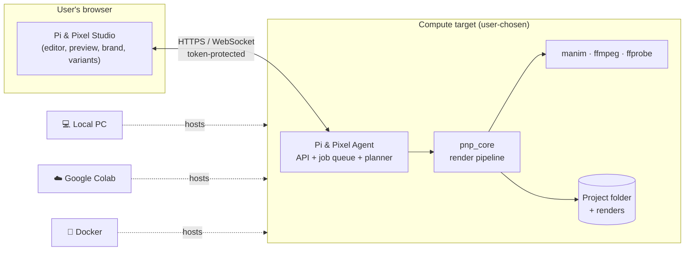

# Pi & Pixel

**A code-first studio for 3Blue1Brown-style explainer videos. Powered by Manim, controlled from the browser, rendered on _your_ machine or Google Colab.**

📄 **New here? Read the 10-page overview first: [`docs/PiAndPixel-Overview.pdf`](docs/PiAndPixel-Overview.pdf)**. It has diagrams, the Studio mockup, the roadmap and sample videos.

| | |
|---|---|
| **Status** | Local Studio MVP in development |
| **What exists today** | Browser Studio, local Manim rendering, multi-clip MP4 export, and optional OpenAI/Deepgram narration |
| **Next milestone** | Continue the roadmap in [`docs/implementation-plan.md`](docs/implementation-plan.md) |
| **Future home** | The content engine inside **ReelMVP** |

---

## What it does (in one minute)

You write a Manim scene (or later, ask AI to write one), preview it in seconds, apply a brand, and export **many videos and variations from one project**: a 16:9 YouTube lesson, a 9:16 reel and a teaser, in several brands and languages.

```
Write → Preview → Debug → Brand → Compose → Render variants → Validate → Export
```

| Capability | What it means |
|---|---|
| 🖥️ **Bring your own compute** | The browser only controls. Rendering runs where the **Agent** runs: your laptop, Docker, or **Google Colab** for people without a strong machine. No render servers to pay for. |
| π **Manim stays Manim** | Scenes are plain Manim Python, with no hidden engine or lock-in. They also run with the normal `manim` command. |
| 🎨 **Brand kits** | Logo anchor (9-point grid or custom), size, margin, opacity, timing, per-format overrides; plus colours and fonts. **Moving a logo never re-renders the animation.** |
| 🧩 **Many videos, many variants** | Compositions × formats (16:9, 9:16, 1:1) × brands × parameters. Shared scenes are rendered once and reused. |
| ✅ **Checked output** | Every MP4 is verified (size, fps, ≤ 30 min) before it is marked done. A failed render never overwrites a good one. |
| 🚚 **ReelMVP-ready** | The pipeline is a headless library plus a CLI. ReelMVP's servers will run the same code. |
| 🤖 **AI assist (later)** | Claude generates and fixes scenes. Its code is always shown as a diff and never auto-runs. |

---

## How it works



All heavy work (Manim, LaTeX, FFmpeg) happens on the compute target. Video data never goes through our servers.

---

## Vision and future

| Horizon | What Pi & Pixel becomes |
|---|---|
| **Now: MVP** | A studio where one person creates branded explainer videos in every format, on their own machine or Colab |
| **Next: ReelMVP integration** | ReelMVP calls Pi & Pixel (CLI / job spec) to produce lesson videos and reels at scale; rendering moves to our servers with sandboxed, autoscaled workers |
| **Later: creative suite** | "Adobe for code-driven animation": AI-assisted scene writing, templates, music and voice, more engines next to Manim, team collaboration |

What stays the same across all three: the render core (`pnp_core`), the scene SDK, the project format and the job spec. Only the hosting changes. See [`docs/architecture.md`](docs/architecture.md) §9.

---

## Roadmap: cycle → car → truck → aeroplane

Each stage is usable on its own. The next stage starts only after the current one's exit test passes. Task-level estimates are in [`AGENTS.md`](AGENTS.md) §4.

| Stage | Goal | Exit test | Estimate |
|---|---|---|---|
| 🚲 **Cycle** | One scene renders and plays in the browser | Click Render → video plays (local + Colab) | ≈ 6 days |
| 🚗 **Car** | Real editing loop, several scenes, one final video | Edit → preview → fix → export a checked MP4 | ≈ 11 days |
| 🚚 **Truck** | Brand kits, formats, variant exports | **CTO demo** runs end to end | ≈ 10 days |
| ✈️ **Aeroplane** | Colab/Docker polish, security, AI, server mode | Ready to plug into ReelMVP | after demo |

**≈ 27 working days to the CTO demo; plan for 6–7 weeks with buffer.**

---

## Sample videos (style references)

These show the visual standard we are aiming for. They are **not** Pi & Pixel output: 3Blue1Brown videos are made with ManimGL, the original library that Manim Community Edition grew out of.

- [But what is a neural network?](https://www.youtube.com/watch?v=aircAruvnKk) · 3Blue1Brown
- [But what is the Fourier Transform? A visual introduction](https://www.youtube.com/watch?v=spUNpyF58BY) · 3Blue1Brown
- [But what is a Fourier series?](https://www.youtube.com/watch?v=r6sGWTCMz2k) · 3Blue1Brown
- [Essence of linear algebra (playlist)](https://www.youtube.com/playlist?list=PLZHQObOWTQDPD3MizzM2xVFitgF8hE_ab) · 3Blue1Brown
- [Manim Community example gallery](https://docs.manim.community/en/stable/examples.html): short clips with source code

🎬 *A Pi & Pixel demo reel ("Pythagoras in 60 seconds", 16:9 + 9:16, two brands) will be added after the 🚚 Truck stage.*

---

## Quick start

> Setting up a new machine? Follow [`docs/dev-setup.md`](docs/dev-setup.md) first. It covers Windows/WSL2, Linux dependencies, locked Python and Studio installs, Manim, FFmpeg, optional provider keys, and the first launch.

```bash
# From the repository root, after installing the prerequisites in docs/dev-setup.md
source scripts/dev-env.sh
uv sync --locked
(cd studio && pnpm install --frozen-lockfile && pnpm build)
uv run --locked pnp doctor
uv run --locked pnp studio ./workspace
```

Open the full tokenized URL printed by the Agent. In the Studio, choose **New project** and select the Pythagoras or Blank template.

**Google Colab (not available yet):** open `colab/PiAndPixel.ipynb` and run the cells. They install dependencies, mount Google Drive and open the Studio through Colab's own proxy. See [ADR-0005](docs/decisions/0005-colab-runtime-mode.md).

A scene reads its context (format, brand theme, parameters) through one import and stays normal Manim:

```python
from manim import *
from pnp import ctx  # falls back to defaults when run with plain `manim`

class Proof(Scene):
    def construct(self):
        self.camera.background_color = ctx.theme.background
        title = Text(ctx.params.get("title", "a² + b² = c²"), color=ctx.theme.primary)
        title.to_edge(UP if ctx.format.is_portrait else UL)
        self.play(Write(title))
```

---

## Core concepts

```
Project
├── Scenes         plain Manim Scene classes in scenes/*.py
├── Assets         images, fonts, audio
├── Brand kits     brands/<name>/brand.yaml   (logo placement, theme)
├── Compositions   "videos": ordered lists of scene clips (+ params, audio)
├── Formats        landscape 1920×1080 · portrait 1080×1920 · square 1080×1080
└── Variants       composition × format × brand × params  →  one MP4 each
```

Full file format: [`docs/project-format.md`](docs/project-format.md).

## Tech stack

| Layer | Choice |
|---|---|
| Animation | Manim Community Edition (pinned) |
| Media | FFmpeg 6+ / ffprobe; LaTeX optional (for `MathTex`) |
| Backend (Agent) | Python 3.12, FastAPI, Pydantic v2 |
| Storage and queue | SQLite (stdlib `sqlite3`, numbered SQL migrations, [ADR-0006](docs/decisions/0006-sqlite-stdlib-job-queue.md)); own SQLite job queue; files / Google Drive |
| Studio (frontend) | React, TypeScript, Vite, Tailwind, Monaco editor, xterm.js |
| Quality | ruff, pyright, pytest · ESLint, Vitest, Playwright |
| Packaging | uv (`pnp` CLI), Docker image, Colab notebook |
| AI (later) | Claude API behind a small provider interface |
| Server mode (later) | Postgres, Redis/SQS, S3, sandboxed containers |

## Documentation

| Document | What's inside |
|---|---|
| [`docs/PiAndPixel-Overview.pdf`](docs/PiAndPixel-Overview.pdf) | **10-page visual overview** for anyone new |
| [`PRD.txt`](PRD.txt) | Original product requirements (v1.0) |
| [`docs/requirements.md`](docs/requirements.md) | Additions: BYO compute, brand kits, variants, ReelMVP; deviations from the PRD |
| [`docs/architecture.md`](docs/architecture.md) | Components, diagrams, data model, trust boundaries, server mode |
| [`docs/project-format.md`](docs/project-format.md) | `pnp.yaml`, `brand.yaml`, scene context, job spec |
| [`docs/rendering-pipeline.md`](docs/rendering-pipeline.md) | Render units, caching, compositing, validation, job states |
| [`docs/security.md`](docs/security.md) | Threat model per compute target |
| [`docs/api.md`](docs/api.md) | Agent REST + WebSocket contract (draft) |
| [`docs/implementation-plan.md`](docs/implementation-plan.md) | Milestones and CTO demo script |
| [`docs/decisions/`](docs/decisions/) | Architecture decision records (ADRs) |
| [`AGENTS.md`](AGENTS.md) | Rules for contributors and Claude Code: git, PRs, code style, build order |

The PDF is generated from [`docs/overview/overview.html`](docs/overview/overview.html):

```bash
google-chrome --headless=new --no-pdf-header-footer --virtual-time-budget=15000 \
  --print-to-pdf=docs/PiAndPixel-Overview.pdf "file://$PWD/docs/overview/overview.html"
```

## Development prerequisites

| Tool | Version | Notes |
|---|---|---|
| Python | 3.12.x | `uv python install 3.12`. Python 3.14 is too new for some Manim dependencies |
| uv | latest | Python env and packages |
| Node.js + pnpm | Node 22 LTS | Studio only |
| FFmpeg | 6+ | `ffmpeg` and `ffprobe` on PATH |
| Cairo, Pango | system packages | `libcairo2-dev libpango1.0-dev` on Debian/Ubuntu |
| LaTeX | TeX Live subset or TinyTeX | Only for `MathTex` / `Tex` |
| Docker | optional | Sandboxed render mode and the agent image |

## License

TBD. Manim Community Edition is MIT-licensed. Fonts and logos in brand kits keep their own licences.
