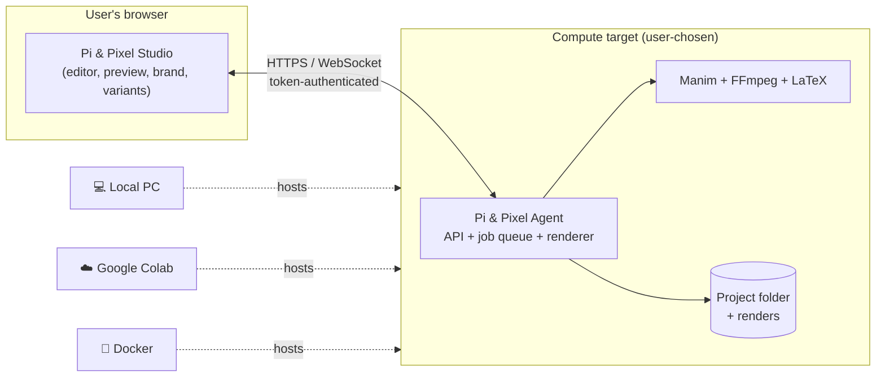

# Pi & Pixel

**A code-first studio for 3Blue1Brown-style explainer videos — powered by Manim, controlled from the browser, rendered on _your_ compute.**

> Status: **Design / Phase 0.** This repository currently contains the product and architecture documentation. No application code exists yet. See [`docs/implementation-plan.md`](docs/implementation-plan.md) for the build order.

---

## What it is

Pi & Pixel is "Adobe for code-driven animation". Users write (or generate with AI) [Manim Community Edition](https://www.manim.community/) scenes, preview them, brand them, and export many videos and variations from one project:

```
Write / generate code → Preview → Debug → Brand → Compose videos → Render variants → Validate → Export
```

It is the content engine that will later plug into **ReelMVP**, where the same render core will run on our own servers.

### Key ideas

| Idea | What it means |
|---|---|
| **Bring-your-own compute** | The browser is only the control surface. Rendering runs on the machine running the **Pi & Pixel Agent**: your laptop, a Docker container, or **Google Colab** for people without a powerful machine. |
| **Manim stays Manim** | Scenes are plain Manim Python. No custom animation engine, no hidden code. A scene that runs in Pi & Pixel also runs with the `manim` CLI. |
| **Brand kits** | Logo (position, size, opacity, timing, per-format overrides), colour theme, fonts, intro/outro. Logo placement is a cheap compositing step, so moving a logo never re-renders the animation. |
| **Many videos, many variants** | A project holds several **compositions** (videos). Each one can be exported as a **variant matrix**, for example `{16:9, 9:16} × {brand A, brand B} × {en, hi}`. Shared scene renders are reused across the matrix. |
| **ReelMVP-ready** | The render pipeline is a headless library (`pnp-core`) with a CLI and JSON job spec. The browser agent is one host for it; ReelMVP's server workers will be another. |

---

## How it runs



All heavy work (Manim, LaTeX, FFmpeg encoding) happens on the compute target. The browser only edits files, starts jobs, streams logs and plays video.

### Planned ways to run it

> These commands describe the **target** developer experience. They will work once Phase 1 is delivered.

**1. Local machine** (best for development)

```bash
uv tool install piandpixel          # Python 3.12, installs the `pnp` CLI
pnp doctor                          # checks Manim, FFmpeg, LaTeX, RAM, CPU
pnp studio ./my-projects            # starts the agent and opens http://127.0.0.1:7860
```

**2. Google Colab** (for low-spec machines)

Open `colab/PiAndPixel.ipynb` and run the cells. They install the dependencies, mount Google Drive for persistent projects, start the agent, and show the Studio through Colab's own port proxy. See [ADR-0005](docs/decisions/0005-colab-runtime-mode.md) for the Colab constraints.

**3. Docker** (zero local dependency setup)

```bash
docker run --rm -p 127.0.0.1:7860:7860 -v "$PWD/projects:/workspace" piandpixel/agent
```

**4. Headless CLI** (CI, batch jobs, future ReelMVP workers)

```bash
pnp render ./pythagoras --composition main --format portrait --brand acme --quality final
pnp export ./pythagoras --all-variants
```

---

## Core concepts

```
Project
├── Scenes         plain Manim Scene classes in scenes/*.py
├── Assets         images, fonts, audio
├── Brand kits     brands/<name>/brand.yaml  (logo placement, theme, intro/outro)
├── Compositions   "videos": ordered lists of scene clips (+ params, audio)
├── Formats        landscape 1920×1080 · portrait 1080×1920 · square 1080×1080
└── Variants       composition × format × brand × params  →  one MP4 each
```

A scene reads its context (format, brand theme, parameters) through a tiny helper and otherwise stays normal Manim:

```python
from manim import *
from pnp import ctx  # falls back to sane defaults when run with plain `manim`

class Proof(Scene):
    def construct(self):
        self.camera.background_color = ctx.theme.background
        title = Text(ctx.params.get("title", "a² + b² = c²"), color=ctx.theme.primary)
        title.to_edge(UP if ctx.format.is_portrait else UL)
        self.play(Write(title))
```

The full file format is in [`docs/project-format.md`](docs/project-format.md).

---

## Repository layout (planned)

```
PiAndPixel/
├── README.md                 ← you are here
├── AGENTS.md                 coding rules for Claude Code / contributors
├── PRD.txt                   original product requirements (v1.0)
├── docs/
│   ├── requirements.md       PRD addendum: BYO compute, branding, variants, ReelMVP
│   ├── architecture.md       components, diagrams, data model, trust boundaries
│   ├── project-format.md     pnp.yaml, brand.yaml, render context (`pnp.ctx`)
│   ├── rendering-pipeline.md render units, caching, compositing, validation
│   ├── security.md           threat model per compute target
│   ├── api.md                agent REST + WebSocket contract
│   ├── implementation-plan.md milestones, CTO demo script, estimates
│   └── decisions/            architecture decision records (ADRs)
├── packages/
│   ├── core/                 pnp_core: headless pipeline (no web deps)
│   ├── agent/                pnp_agent: FastAPI app, SQLite job queue, serves Studio
│   └── sdk/                  pnp: tiny helper imported inside scenes (ctx)
├── studio/                   React + TypeScript + Vite + Monaco + xterm.js
├── colab/                    PiAndPixel.ipynb launcher notebook
├── docker/                   agent image (Manim, FFmpeg, TeX subset)
└── examples/                 starter projects (also used as render tests)
```

## Tech stack

| Layer | Choice | Why |
|---|---|---|
| Studio UI | React + TypeScript + Vite, Monaco editor, xterm.js | Mature editor and terminal; built as a static bundle served by the agent |
| Agent API | Python 3.12 + FastAPI + WebSockets | Same language as Manim; 3.12 matches Colab |
| Job queue | SQLite-backed durable queue (in-agent) | No Redis to install on a laptop or Colab; can be swapped later ([ADR-0002](docs/decisions/0002-local-first-storage-and-queue.md)) |
| Metadata | SQLite (`.pnp/state.db`) | Single file, survives restarts, can be moved to Postgres in server mode |
| Storage | Project folder on disk (or Drive in Colab) | Git-friendly and user-owned; S3 adapter for server mode |
| Animation | Manim Community Edition (pinned) | The engine. Wrapped, never replaced |
| Media | FFmpeg / FFprobe | Logo overlay, concatenation, audio, encoding, validation |
| AI (P1) | Provider interface, Claude by default | Optional; generated code uses the same execution path |
| Tooling | uv, ruff, pyright, pytest · pnpm, eslint, vitest, Playwright | |

## Documentation

- **Start here:** [`docs/architecture.md`](docs/architecture.md)
- What we are adding on top of the PRD: [`docs/requirements.md`](docs/requirements.md)
- Build order and CTO demo: [`docs/implementation-plan.md`](docs/implementation-plan.md)
- Why we chose what we chose: [`docs/decisions/`](docs/decisions/)

## Development prerequisites

| Tool | Version | Notes |
|---|---|---|
| Python | 3.12.x | Install via `uv python install 3.12`. System Python 3.14 is too new for some Manim dependencies |
| uv | latest | Python env and package manager |
| Node.js + pnpm | Node 22 LTS | Studio only |
| FFmpeg | 6+ | `ffmpeg` and `ffprobe` on PATH |
| Cairo, Pango | system packages | Manim rendering (`libcairo2-dev libpango1.0-dev` on Debian/Ubuntu) |
| LaTeX | TeX Live subset or TinyTeX | Only needed for `MathTex` / `Tex` |
| Docker | optional | Sandboxed render mode and the agent image |

## License

TBD. Manim Community Edition is MIT-licensed. Fonts and logos in brand kits keep their own licences.
