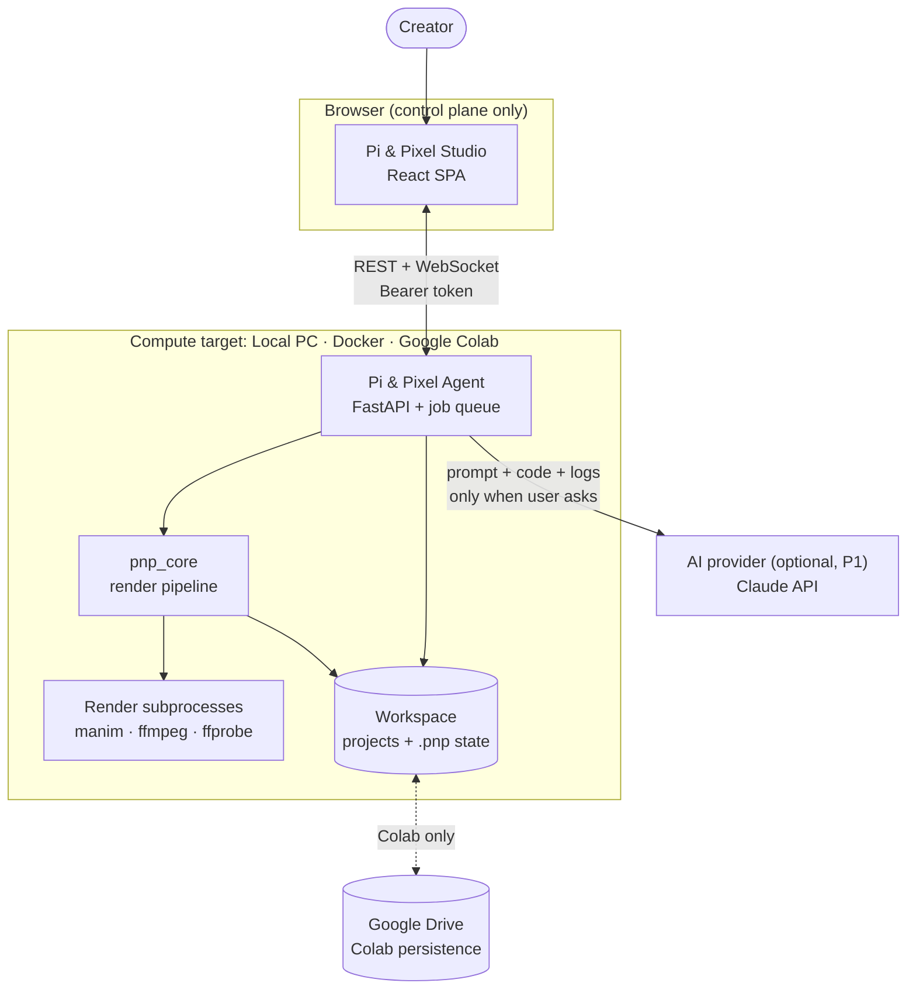
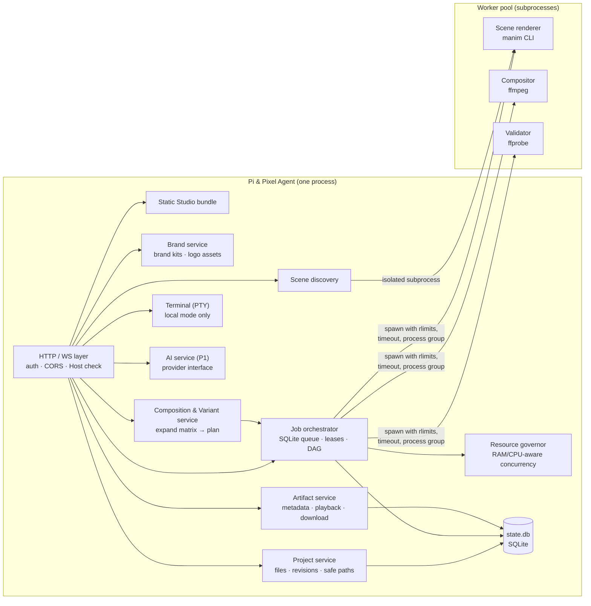
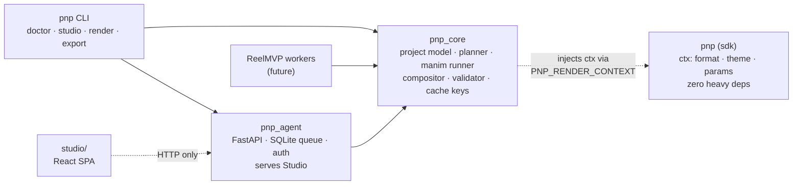
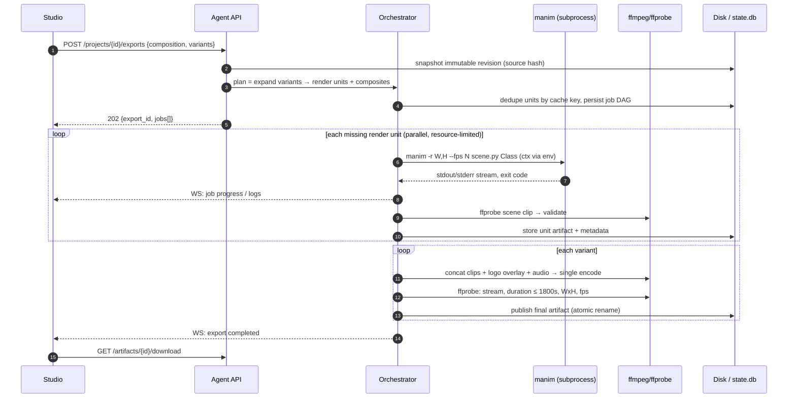
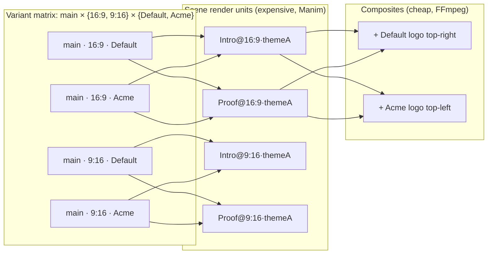
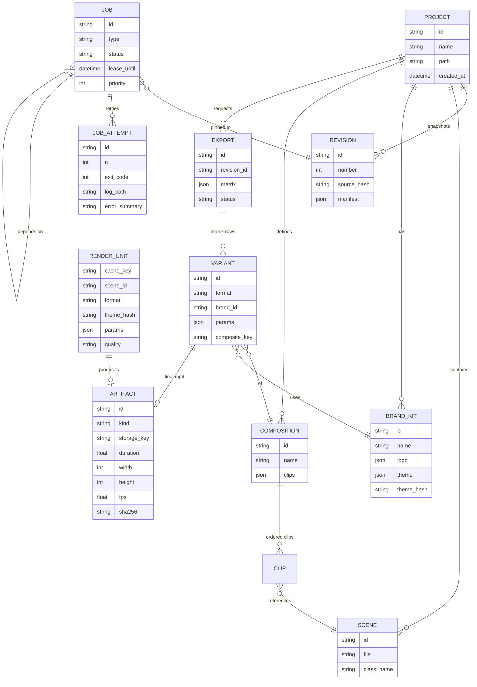
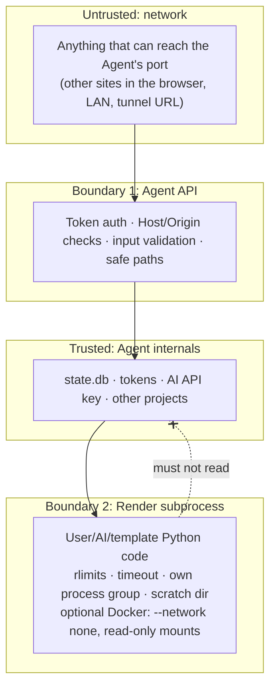
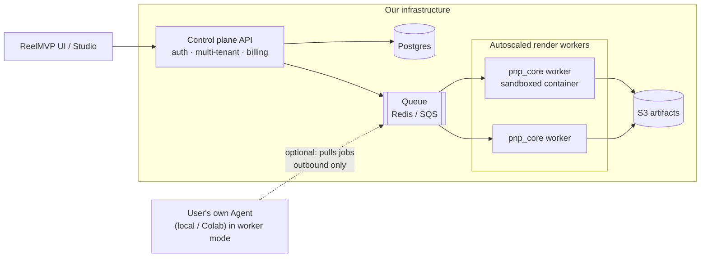

# Architecture

This document describes the components of Pi & Pixel, how data moves between them, and where the trust boundaries are. It extends PRD §7 for **bring-your-own compute** ([ADR-0001](decisions/0001-bring-your-own-compute.md)).

## 1. Guiding principles

1. **Control plane in the browser, compute on the user's machine.** The Studio never renders. The Agent does all CPU, RAM and disk work.
2. **One render core, many hosts.** `pnp_core` is a headless library. The local Agent, the Colab Agent, the CLI and the future ReelMVP server workers all call the same code.
3. **Manim stays untouched.** We orchestrate the `manim` process; we never re-implement Manim classes (PRD §1.3, FR-009).
4. **Render once, composite many.** Expensive Manim renders are keyed by what actually changes the pixels. Branding overlays, ordering, audio and encoding run as a cheap FFmpeg composite step.
5. **Modular monolith.** One Agent process plus render subprocesses. No microservices until measured load requires them (PRD Risk 6).

---

## 2. System context

### Compute targets

| Target | Who it's for | How the browser reaches it | Persistence |
|---|---|---|---|
| **Local** | Developers and creators with a decent PC | `http://127.0.0.1:7860`, bound to loopback only | Local folder |
| **Docker** | Anyone who wants no dependency setup | Published to `127.0.0.1` only | Bind-mounted folder |
| **Colab** | Users with low-spec machines | Colab's built-in port proxy, inside or next to the notebook | Google Drive (synced) |
| **Server** *(post-MVP, ReelMVP)* | ReelMVP production | Hosted control plane, with Agents in worker mode | Postgres + S3 |

---

## 3. Agent internals

| Module | Responsibility | PRD ref |
|---|---|---|
| HTTP/WS layer | REST `/api/v1`, event stream, token auth, CORS allowlist, Host-header check (prevents DNS rebinding) | §7.5, SEC-005 |
| Project service | Create/open/rename/delete, file CRUD through `safe_join`, immutable revision snapshots | FR-001…007 |
| Scene discovery | AST scan first (no execution); optional import-based discovery inside a render subprocess | FR-011, FR-012 |
| Brand service | Brand-kit CRUD, logo upload and validation (PNG/SVG, size limits), placement config | FR-110…114 |
| Composition & Variant service | Compositions (videos), formats, variant matrix expansion, render-plan preview and dedupe | FR-120…126 |
| Job orchestrator | Durable queue in SQLite, job DAG (scene units → composite → validate), leases, retry, cancel, crash recovery | FR-010, 017…020 |
| Resource governor | Picks worker concurrency from free RAM and CPU; previews take priority over final renders | §8.4, FR-103 |
| Workers | Subprocesses: `manim`, `ffmpeg`, `ffprobe`. Never inside the API process | SEC-001, SEC-004 |
| Artifact service | Artifact metadata, range-request playback, authorized download, retention | FR-025…027 |
| Terminal | PTY over WebSocket, enabled only on loopback-bound local mode | FR-008 |
| AI service (P1) | Generate, modify and debug through a provider interface; output is shown as a diff and never auto-run | FR-028…032 |

---

## 4. Package boundaries

- **`pnp` (sdk)** is imported *inside the user's scene process*. It must stay tiny and safe to import anywhere, and it falls back to defaults when no context is present.
- **`pnp_core`** has no web dependencies. This is the piece ReelMVP will reuse.
- **`pnp_agent`** is the only package that knows about HTTP, auth and the browser.

---

## 5. Render flow (one export)

Details: [`rendering-pipeline.md`](rendering-pipeline.md).

---

## 6. Variants: render once, composite many

If both brands share the same **theme** (colours and fonts used *inside* scenes), the four variants need only **four Manim renders, not eight**. Changing a logo's position, size or opacity re-runs only the composite step. A different theme or format creates new render units, because the pixels really do change.

---

## 7. Data model (SQLite in MVP, Postgres in server mode)

The state database is one SQLite file per workspace, **`<workspace>/.pnp/state.db`** (WAL mode, plain `sqlite3` with numbered SQL migrations, see [ADR-0006](decisions/0006-sqlite-stdlib-job-queue.md)). It holds revisions, exports, jobs, job dependencies and job attempts. Revision snapshots, attempt logs and artifacts are files under each project's `.pnp/` folder.

Projects, scenes, brand kits and compositions live **in files** (`pnp.yaml`, `brand.yaml`, `scenes/*.py`) so that they are portable and git-friendly. The database **indexes** them and stores job state and artifact metadata. Binary media are never stored in the database (PRD §7.4).

**Single-user MVP:** the PRD's `User` / `owner_id` model is deferred. Each Agent belongs to one person and is protected by a token. Ownership columns come back in server mode ([ADR-0002](decisions/0002-local-first-storage-and-queue.md)).

---

## 8. Trust boundaries

Full threat model per compute target: [`security.md`](security.md).

---

## 9. Future: server mode for ReelMVP (post-MVP)

What carries over unchanged: `pnp_core`, the `pnp` sdk, the project format, the job spec, and the Studio components. What changes: auth becomes multi-tenant, SQLite becomes Postgres, the in-process queue becomes Redis/SQS, disk becomes S3, and sandboxing becomes mandatory (containers or gVisor, no network), which restores the full PRD §9 model.
