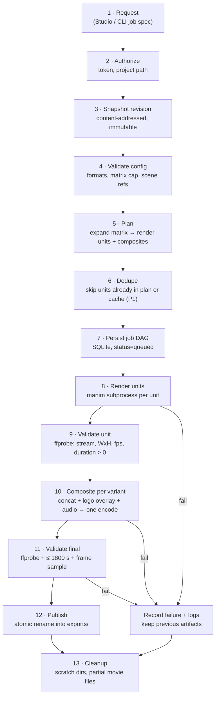
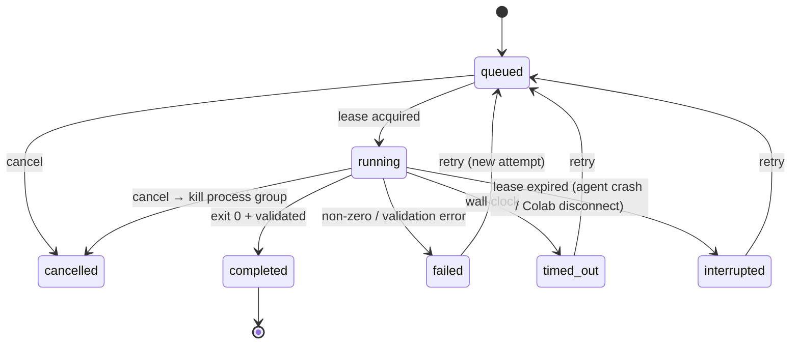

# Rendering Pipeline

This implements PRD §8 with bring-your-own compute, brand kits and variants.

## 1. Stages



## 2. Render units

A **render unit** is the smallest piece of Manim work: one scene at one format, theme, params and quality.

```
cache_key = sha256(
    revision.source_hash,       # hash of all *.py under scenes/ + referenced assets (MVP: whole tree)
    scene_ref,                  # "scenes/proof.py:Proof"
    format.width, format.height, fps,
    theme_hash,                 # hash of brand.theme only; NOT logo
    canonical_json(params),
    quality,
    manim_version, python_version, pnp_sdk_version
)
```

The MVP hashes the whole source tree. That is correct, but it over-invalidates when an unrelated file changes. Per-scene dependency closure is a P1 optimisation (PRD §8.3: correctness first).

### Invocation

```
manim render scenes/proof.py Proof \
  --resolution 1080,1920 --fps 30 \
  --media_dir <scratch>/media \
  --format mp4 --disable_caching \
  --progress_bar display
env: PNP_RENDER_CONTEXT=<scratch>/ctx.json
cwd: <scratch>/src   (a copy of the revision snapshot, not the live project)
```

- The **quality presets** map to resolutions scaled from the format: draft = ¼ resolution at 15 fps, preview = ½ resolution at 30 fps, final = full resolution at 30 fps.
- Rendering from a **snapshot copy** guarantees that what was rendered is what was recorded (AC-012), and the user can keep editing during a render.
- Manim's internal cache is disabled; our cache key replaces it.

### Process controls (SEC-004)

| Control | Mechanism (POSIX) | Windows/Colab note |
|---|---|---|
| Wall-clock timeout | Orchestrator timer → SIGTERM, then SIGKILL after 10 s | same timer, `taskkill /T` |
| Kill whole tree | `start_new_session=True`, `os.killpg` | Job Object (P1) |
| Memory cap | `RLIMIT_AS` via `preexec_fn` (configurable, default from benchmarks) | Colab: Linux, supported |
| Process count | `RLIMIT_NPROC` | best effort |
| Output size | Check scratch dir size during the run; abort over limit | same |
| Sandbox (opt-in) | `docker run --network none --memory … --cpus … -v snapshot:ro` | not available in Colab |

## 3. Progress reporting (FR-018)

- **Render units:** Manim prints `Animation N: …` progress lines. We report *animations completed* and elapsed time. Percentages appear only within the current animation, where Manim provides them. We never invent a total percentage, because the animation count is unknown before execution (PRD FR-018).
- **Composite:** FFmpeg `-progress pipe:1` gives `out_time`. The total duration is known (sum of clip durations), so composite progress percentage **is** reliable.
- **Export:** shows `units done / units total` plus composites done / total. These are real counts.

Events go over `WS /api/v1/events` (see [`api.md`](api.md)).

## 4. Compositing a variant

One FFmpeg pass per variant does concatenation, logo overlay and audio. This means one encode and no generational quality loss.

```
ffmpeg -f concat -safe 0 -i clips.txt          # unit clips, identical WxH/fps/pix_fmt
       -i logo_<W>x<H>.png                     # pre-rasterised for this format (SVG → PNG)
       [-stream_loop -1 -i music.mp3]
  -filter_complex "
     [1:v]format=rgba,colorchannelmixer=aa=0.9[lg];
     [0:v][lg]overlay=x=W-w-M:y=M:enable='between(t,0,T)'[v]"
  -map "[v]" [-map 2:a -af "volume=0.4,afade=t=out:st=T-2:d=2" -shortest]
  -c:v libx264 -preset medium -crf 18 -pix_fmt yuv420p -r 30
  -c:a aac -b:a 192k
  -movflags +faststart
  -progress pipe:1
  <scratch>/out.mp4
```

- Logo position comes from the anchor, margin, size and per-format overrides, computed in `pnp_core.compositor.layout`. The browser placement preview uses the **same** math (shared test vectors), so preview and output match.
- If no overlay or audio is needed and all clips match, use `-c copy` concat for speed (PRD FR-023).
- Before concatenation, verify that every clip has identical width, height, fps, pix_fmt and codec. A mismatch is a bug in planning, not something to paper over.

## 5. Validation (FR-024)

A final artifact is published only if `ffprobe` confirms:

1. The file exists and is readable, with exactly one video stream.
2. `width × height` equals the requested format.
3. `r_frame_rate` equals the requested fps.
4. `0 < duration ≤ 1800 s`.
5. The duration is within ±1 frame per clip of the sum of the unit durations (catches truncated or black-padded joins).
6. (P1) A sampled frame shows non-transparent logo pixels inside the expected bounding box (AC-103).

On failure: status `failed`, logs kept, scratch output discarded, and previous exports untouched (AC-007).

## 6. Job states and recovery



- Each attempt has its own log file and scratch dir. Retries never reuse a previous attempt's scratch dir (PRD FR-020).
- On Agent start: every `running` job with an expired lease becomes `interrupted`, and its scratch dir is deleted (AC-011).
- Publishing is an atomic `rename` within the same filesystem, so a crash never leaves a half-written file marked `completed`.
- Composite jobs depend on their units. If any unit fails, its dependents become `blocked` and are surfaced in the UI. They are not silently skipped.

## 7. Resource governor

```
slots = clamp(1, floor((free_ram − reserve) / per_job_budget), cpu_count − 1)
```

- `reserve` (default 1.5 GB) keeps the OS and browser responsive.
- `per_job_budget` defaults per quality (draft < preview < final) and is **calibrated by the Phase 0 benchmark** before any number is published.
- Re-evaluated before each job start. Jobs wait with reason `waiting_for_memory` rather than starting and getting OOM-killed.
- Priority: `preview` > `unit (final)` > `composite`. FIFO within a priority.
